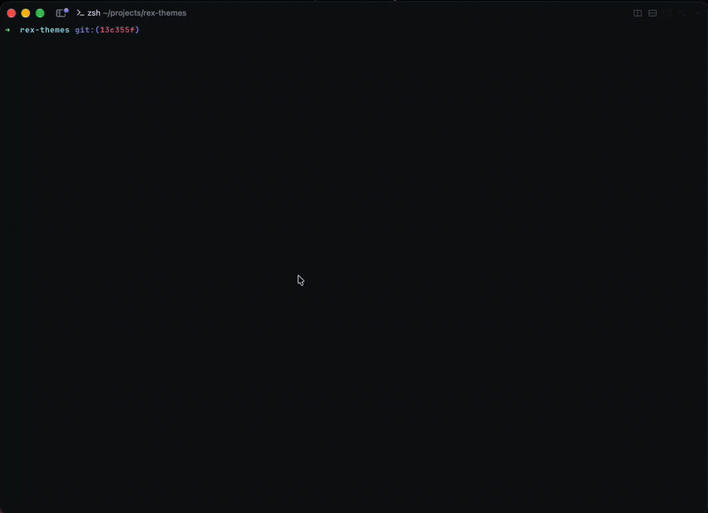

# rex-themes

Color themes for the Rex terminal, with a small CLI to use and grow the library.



## Install

```sh
git clone https://github.com/AlbertoBarrago/rex-themes.git
cd rex-themes
./install.sh            # links bin/rex-theme into ~/.local/bin
./install.sh /usr/local/bin   # or any other directory on PATH
```

Requires Python 3 and `rex` on `PATH`. The install is a symlink, so `git pull` updates the CLI and the themes together.

## Usage

```sh
rex-theme list                  # themes in the library, with dark/light
rex-theme use dracula           # import into Rex.app and select it (persists, shows in the theme picker)
rex-theme try nord              # color only the current block, app theme untouched
rex-theme reset                 # undo `try`
rex-theme current               # the app's selected dark and light themes
rex-theme add "Catppuccin Frappe" catppuccin-frappe   # add from iTerm2-Color-Schemes
rex-theme add --file ~/my-theme my-theme              # add a local Ghostty theme file
```

`use` calls the app action `client.theme.import`, so Rex.app must have **Remote Control** turned on (Settings, Rex Server). `try` and `reset` take `-b BLOCK` to target a block other than `$REX_BLOCK` (or the focused one).

## Themes

| Name | Scheme | Source |
| --- | --- | --- |
| `albz` | dark | Alberto Barrago's Ghostty palette |
| `catppuccin-latte` | light | Catppuccin Latte |
| `catppuccin-mocha` | dark | Catppuccin Mocha |
| `dracula` | dark | Dracula |
| `gruvbox-dark` | dark | Gruvbox Dark |
| `night-owl` | dark | Night Owl |
| `nord` | dark | Nord |
| `one-dark` | dark | Atom One Dark |
| `rose-pine` | dark | Rose Pine |
| `solarized-light` | light | iTerm2 Solarized Light |
| `tokyo-night` | dark | TokyoNight |

## Theme format

Every theme is two files in `themes/`:

- `<name>.ghostty`: the source, in Ghostty's `key = value` format. This is what `use` imports into Rex.app.
- `<name>.json`: the arguments of the `com.superlogical.terminal.set_theme` block action, generated by `rex-theme add`. This is what `try` sends.

```json
{
  "palette": ["0=#21222c", "1=#ff5555", "..."],
  "background": "#282a36",
  "foreground": "#f8f8f2",
  "cursor": "#f8f8f2",
  "scheme": "dark"
}
```

The action rejects unknown keys, so the JSON carries no metadata: credits live in the table above. Both files work without the CLI:

```sh
rex do com.superlogical.terminal.set_theme --args @themes/dracula.json
rex do client.theme.import path="$PWD/themes/dracula.ghostty"
```

## Credits

Except `albz`, colors come from [iTerm2-Color-Schemes](https://github.com/mbadolato/iTerm2-Color-Schemes) (MIT, Mark Badolato), which collects schemes from their original authors.

## License

MIT
